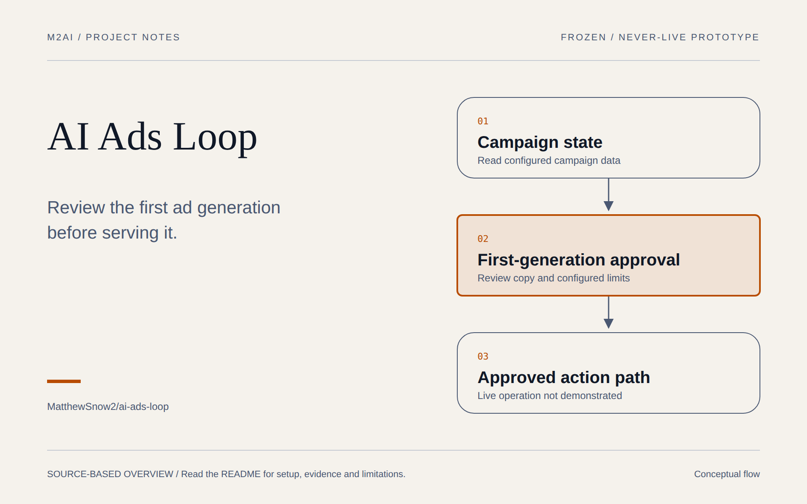

# AI Google Ads Loop



Testing ad copy is a loop: write a variation, publish it, collect enough evidence and decide what to keep. This Python prototype separates those steps into copy generation, campaign metrics, an experiment ledger and a human approval step for the first generation.

**Status: frozen prototype.** The checked-in project note records that it was parked on 13 July 2026 and had never gone live. This is an implementation example, not evidence of campaign uplift, lower acquisition cost or production operation.

## What the source demonstrates

- Responsive Search Ad copy generation through Anthropic, with headline and description limits.
- Google Ads and dry-run client implementations behind a shared interface.
- SQLite records for campaigns, copy generations, metrics, experiments and kill-switch events.
- First-generation approval before serving copy, plus a spend-threshold check and campaign pause path.
- A mutation cooldown and comparison rules for evaluating variants.

Later generations do not receive the first-generation approval prompt. The runner does not change campaign budgets. These are code boundaries to review, not a validated guarantee about an operating account.

## Set up for inspection

Use Python 3.10 or later, Git and a virtual environment. The source files use relative imports from the repository root. Clone into a directory named `ai_ads_loop` and invoke it as a package **from its parent directory**:

```bash
git clone https://github.com/MatthewSnow2/ai-ads-loop ai_ads_loop
python3 -m venv .venv-ai-ads
source .venv-ai-ads/bin/activate
python -m pip install -r ai_ads_loop/requirements.txt
python -m ai_ads_loop.runner --status
```

On a fresh checkout, expect `No campaigns found.` This initializes the local SQLite schema at `ai_ads_loop/data/ai_ads_loop.db`; it does not create an Ads campaign. No API credentials are required for this empty local status path. The configuration module reads an existing `~/.env.shared` file if present.

## First walkthrough

1. Run the local status command above before adding campaign records.
2. Read [runner.py](runner.py) in order: metrics, threshold check, active experiment, cooldown, generation, approval and application.
3. Inspect [repository.py](repository.py) to see how each stage is recorded. The repository does not ship a campaign setup CLI or seed fixture, so a fresh database cannot demonstrate a full experiment.
4. Compare [ads_client.py](ads_client.py)'s real and dry-run implementations. Use the dry-run client only with an isolated database and an explicit understanding of the model calls below.

**Critical dry-run limit:** `python -m ai_ads_loop.runner --dry-run` substitutes the Google Ads client, but it can still call Anthropic to generate copy when active campaigns exist, incur model charges and write the local database. It is not an offline or read-only simulation, despite the CLI help text. Do not use it as a no-spend verification command.

## Configuration for further development

[.env.example](.env.example) lists credential names. [config.py](config.py) reads your environment and the shared credential file. Keep credentials outside Git; on ProBook source `~/.env.shared` first. The relevant variables are:

- `GOOGLE_ADS_CUSTOMER_ID`, `GOOGLE_ADS_DEVELOPER_TOKEN`, `GOOGLE_ADS_CLIENT_ID`, `GOOGLE_ADS_CLIENT_SECRET`, `GOOGLE_ADS_REFRESH_TOKEN` and `GOOGLE_ADS_LOGIN_CUSTOMER_ID`.
- `GOOGLE_ADS_TEST_ACCOUNT_ID`, which is declared in configuration but should not be assumed to redirect the real client automatically. Inspect the client account selection before any run.
- `ANTHROPIC_API_KEY` and optional `ANTHROPIC_MODEL`. Verify current provider model availability before enabling inference.

A live run can publish ads and affect spend. Before developing that path, supply an isolated test account, review the approval and pause behavior, and verify the account actually selected by the client. This documentation cleanup does not authorize or validate a live campaign.

## Verification and limits

No automated tests or reproducible campaign fixture are included. Inspecting an empty status database proves only that local initialization and imports work. It does not validate advertising behavior.

Experiment promotion currently updates local records; the runner itself marks fine-grained pausing of prior ads as future work. That limits claims about automatic winner rollout. Dependencies are lower-bounded rather than locked, and the dated project note is not a current provider compatibility check.

| Module | Responsibility |
| --- | --- |
| [config.py](config.py) | Environment, model selection, thresholds and storage path |
| [repository.py](repository.py) | SQLite access and schema |
| [ads_client.py](ads_client.py) | Google Ads and dry-run clients |
| [copy_generator.py](copy_generator.py) | Initial copy and variants |
| [evaluator.py](evaluator.py) | Comparison rules |
| [kill_switch.py](kill_switch.py) | Spend threshold and pause action |
| [runner.py](runner.py) | Orchestration and first-generation approval |

## License

MIT. See [LICENSE](LICENSE).
